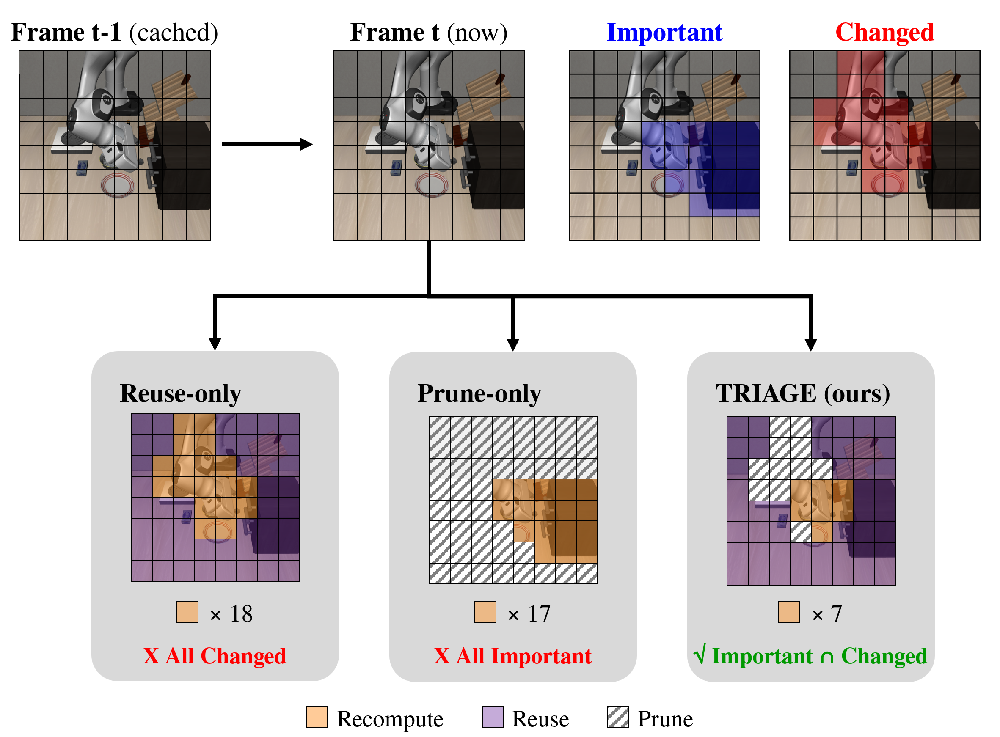

# TRIAGE

Official implementation of **TRIAGE: Efficient Vision-Language-Action Inference Needs Both Reuse and Pruning**.

[](#citation)
[](LICENSE)

<p align="center">
  
</p>

## Overview

TRIAGE is a training-free inference method for vision-language-action (VLA) models. Existing accelerators recompute only a subset of the visual tokens and send every other token to a single fate: prune-only methods discard them, and reuse-only methods serve their cached key-value (KV) states. TRIAGE instead decides per token whether to recompute, reuse, or prune it.

The decision rests on a token-level diagnostic. Reusing a token whose shallow-layer value has drifted little since its cache was computed is no worse than pruning it, but beyond a drift threshold, reuse yields up to 4.4x the action error of pruning. TRIAGE therefore treats a cache as valid when its drift is below this threshold and it is not too old. It recomputes a fixed budget of tokens, prioritizing important tokens with invalid caches, reuses every other token with a valid cache, and prunes the rest. Because the budget fixes the number of recomputed tokens, it directly sets the prefill latency.

On LIBERO and SimplerEnv, TRIAGE stays within **3 pp** of full recomputation in average success rate while cutting prefill latency on a Jetson AGX Orin by up to **48%**. With only **7%** of visual tokens recomputed, it beats the strongest baseline by **24.4 pp** on LIBERO-Object.

The repository supports two backbones:

- `src/openvla/`: OpenVLA-7B (256 visual tokens, autoregressive action decoding).
- `src/openvla-oft/`: OpenVLA-OFT (512 visual tokens from two cameras, 8-step action chunk in one forward pass).

## Abstract

Vision-language-action (VLA) models are increasingly used for robot manipulation because they map camera images and a language instruction directly to actions. Robots that cannot be tethered to a workstation, such as mobile manipulators and humanoids, must run them on onboard embedded boards, where the prefill latency of the language backbone grows with the hundreds of visual tokens processed at every control step. To meet real-time limits, training-free accelerators recompute only a subset of the visual tokens and skip the rest, either by pruning them or by reusing their cached key-value (KV) states. The two options save nearly the same computation, yet existing methods apply only one of them to every skipped token.

Through a token-level diagnostic, we show that which option keeps the action closer to full recomputation depends on the token's drift, the change in its shallow-layer value since its cache was computed. On both backbones tested, reusing tokens below a drift threshold was no worse than pruning them, whereas beyond it, reuse yields up to 4.4x the action error of pruning; the same diagnostic calibrates this threshold per backbone.

Building on this finding, we propose TRIAGE, which deems a cache valid when its drift is below this threshold and it is not too old. TRIAGE recomputes a fixed budget of tokens, prioritizing important tokens with invalid caches, reuses every other token with a valid cache, and prunes the rest; prune-only and reuse-only methods are the two extremes of this partition. Because the budget fixes the number of recomputed tokens, it directly sets the prefill latency. On LIBERO and SimplerEnv, TRIAGE stays within 3 pp of full recomputation in average success rate while cutting prefill latency on a Jetson AGX Orin by up to 48%, and with only 7% of visual tokens recomputed, it beats the strongest baseline by 24.4 pp on LIBERO-Object.

## Repository Structure

```text
.
|-- figure_1.png                          # Overview figure
|-- scripts/
|   `-- reproduce_libero.sh               # Runs all four LIBERO suites
|-- simpler/
|   `-- simpler_openvla.patch             # TRIAGE patch for SimplerEnv-OpenVLA
`-- src/
    |-- openvla/                          # OpenVLA with TRIAGE added
    |   |-- prismatic/extern/triage.py    # TRIAGE engine (replaces LlamaModel.forward)
    |   |-- prismatic/extern/hf/modeling_prismatic.py  # VLA-Cache model file
    |   `-- experiments/robot/
    |       |-- triage_utils.py           # Model loading, per-query state, defaults
    |       `-- libero/run_libero_eval.py # LIBERO evaluation entry point
    `-- openvla-oft/                      # OpenVLA-OFT with TRIAGE added
        |-- prismatic/extern/triage.py
        `-- experiments/robot/
            |-- triage_utils.py
            `-- libero/run_libero_eval.py
```

All other files under `src/` are the upstream OpenVLA and OpenVLA-OFT code.

## Setup

Each backbone needs its own environment, because the two trees ship different `prismatic` packages. Both pin PyTorch 2.2.0, `tokenizers` 0.21.1, and the VLA-Cache `transformers` fork at commit `2302fce`.

```bash
# OpenVLA
conda create -n triage-openvla python=3.10 -y && conda activate triage-openvla
pip install -e src/openvla

# OpenVLA-OFT
conda create -n triage-oft python=3.10 -y && conda activate triage-oft
pip install -e src/openvla-oft
```

Install LIBERO in each environment:

```bash
git clone https://github.com/Lifelong-Robot-Learning/LIBERO.git
pip install -e LIBERO --config-settings editable_mode=compat
pip install -r src/openvla/experiments/robot/libero/libero_requirements.txt
```

`editable_mode=compat` is needed with recent `setuptools`, which otherwise installs LIBERO so that `import libero` fails. The requirements file pins `numpy` 1.26.4 and `mujoco` 2.3.7, the versions used for the paper; without the pins, pip installs NumPy 2, which PyTorch 2.2.0 cannot load.

## Checkpoints

We use the public LIBERO checkpoints of each backbone, and the base OpenVLA checkpoint on SimplerEnv. They are downloaded on first use into `src/openvla/checkpoints/` or `src/openvla-oft/checkpoints/`:

- OpenVLA: `openvla/openvla-7b-finetuned-libero-*`
- OpenVLA-OFT: `moojink/openvla-7b-oft-finetuned-libero-*`
- SimplerEnv: `openvla/openvla-7b`

## LIBERO Evaluation

Run from `src/openvla` or `src/openvla-oft`:

```bash
export MUJOCO_GL=osmesa PYOPENGL_PLATFORM=osmesa

cd src/openvla
python experiments/robot/libero/run_libero_eval.py --task_suite_name libero_spatial

cd src/openvla-oft
python experiments/robot/libero/run_libero_eval.py --task_suite_name libero_goal
```

To reproduce all four suites (500 episodes each, split into trials 0-24 and 25-49 as in the paper):

```bash
scripts/reproduce_libero.sh openvla
scripts/reproduce_libero.sh openvla-oft
```

Results are written to `src/openvla/results/` or `src/openvla-oft/results/` as `<suite>_trials<a>-<b>.jsonl`, one `episode` record per episode. An interrupted run resumes from the episodes already logged. Add `--log_steps` to also record the recomputed rows and prefill time of every query.

The paper numbers were produced with OSMesa rendering. EGL rendering can change pixels slightly, and with them the rollouts.

### Hyperparameters

The defaults in `triage_utils.py` match the paper. Notation follows Section IV.

| Paper | Code | OpenVLA | OFT | OFT, LIBERO-Goal |
| --- | --- | --- | --- | --- |
| Recompute budget `B` | `b_vis` | 88 | 163 | 91 |
| Important set size `B + κ` (κ = 70) | `n_important` | 158 | 233 | 161 |
| Signal layer `ℓs` | `prune_layer - 1` | 2 | 2 | 2 |
| Drift threshold `δ` | `delta` | 0.3 | 0.3 | 0.3 |
| Cache age limit `T` | `max_age` | 10 | 10 | 10 |
| Maintenance fraction `µ` | `maint_ratio` | 0.06 | 0.06 | 0.06 |
| Forecast weight `λ` | `lam` | 1.0 | 1.0 | 1.0 |
| Tokens recomputed at the first query | `first_bvis` | 227 | 163 | 163 |
| Hysteresis on the important set | `hysteresis` | 1.25 | 1.25 | 1.25 |

`B` matches SAFE-Pruner's FLOPs. The last two rows are implementation settings not described in the paper. On OpenVLA-OFT, the LIBERO-Goal values (`B = 91`, `n_important = 161`) are applied automatically when `--task_suite_name libero_goal` is given.

The following can be overridden from the command line: `--b_vis`, `--n_important`, `--first_bvis`, `--prune_layer`, `--max_age`, `--delta`, `--maint_ratio`, and `--hysteresis`. For example, `--b_vis 28 --n_important 98` runs one point of the budget sweep in Fig. 4. `λ` has no command-line option; change `lam` in `triage_utils.py` instead.

## SimplerEnv Evaluation

The SimplerEnv runs use the OpenVLA settings above without retuning.

1. Set up [SimplerEnv-OpenVLA](https://github.com/DelinQu/SimplerEnv-OpenVLA) in an environment where `src/openvla` is installed.
2. Apply the patch and run the evaluations:

```bash
cd SimplerEnv-OpenVLA
git checkout ccfe380
git apply /path/to/TRIAGE/simpler/simpler_openvla.patch
export PYTHONPATH=/path/to/TRIAGE/src/openvla:$PYTHONPATH

bash scripts/move_near_visual_matching.sh openvla/openvla-7b openvla -0.8 <log_dir> <gpu>
bash scripts/move_near_variant_agg_240.sh openvla/openvla-7b openvla -0.8 <log_dir> <gpu>
bash scripts/pick_coke_can_variant_agg_240.sh openvla/openvla-7b openvla -0.8 <log_dir> <gpu>
```

The patch replaces the policy call with TRIAGE, resets the cache at the start of every episode, and adds the two Variant Aggregation scripts with 240 episodes.

## Acknowledgements

This code builds on [OpenVLA](https://github.com/openvla/openvla), [OpenVLA-OFT](https://github.com/moojink/openvla-oft), [VLA-Cache](https://github.com/siyuhsu/vla-cache) (whose `transformers` fork and OpenVLA model file are used here), [SAFE-Pruner](https://github.com/msssl/SAFE-Pruner) (whose deep-layer saliency forecast TRIAGE uses for importance), [LIBERO](https://github.com/Lifelong-Robot-Learning/LIBERO), and [SimplerEnv](https://github.com/simpler-env/SimplerEnv).

## Citation

If you use TRIAGE in your research, please cite:

```bibtex
@inproceedings{kwon2026triage,
  author    = {Kwon, Sooyoung and Joe-Wong, Carlee and Lee, Kyunghan},
  title     = {{TRIAGE}: Efficient Vision-Language-Action Inference Needs Both Reuse and Pruning},
  booktitle = {TBD},
  year      = {2026}
}
```

## License

This project is released under the [MIT License](LICENSE). The upstream OpenVLA and OpenVLA-OFT code under `src/openvla` and `src/openvla-oft` keeps its original MIT license and copyright notice (see the `LICENSE` file in each directory).
